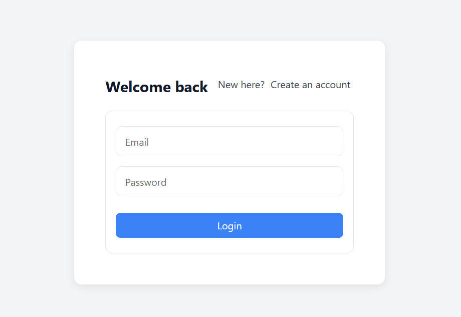
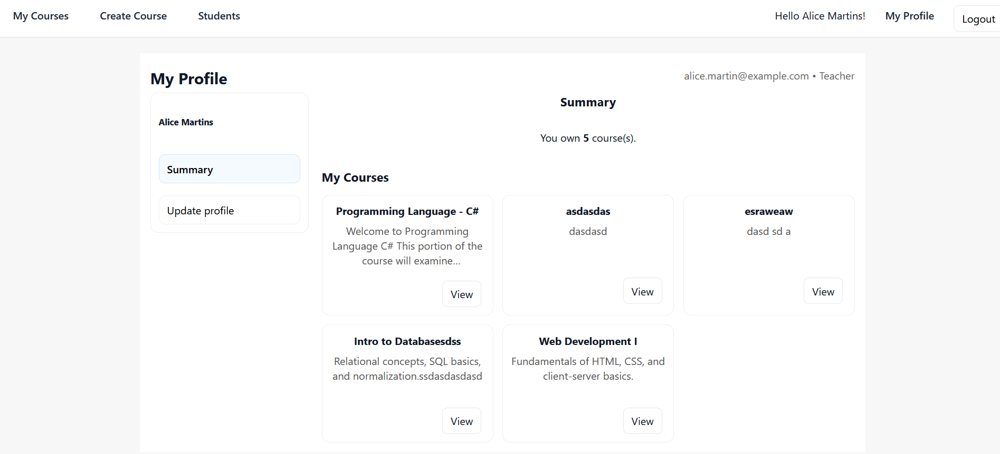
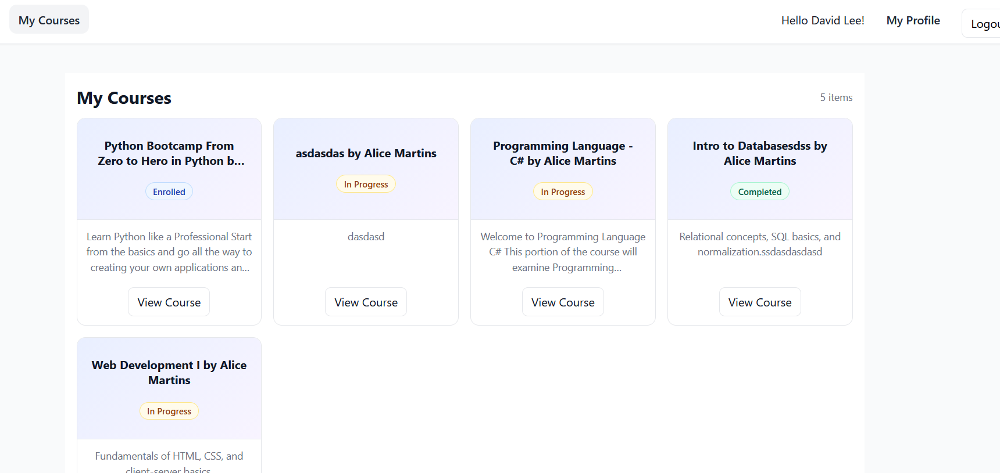
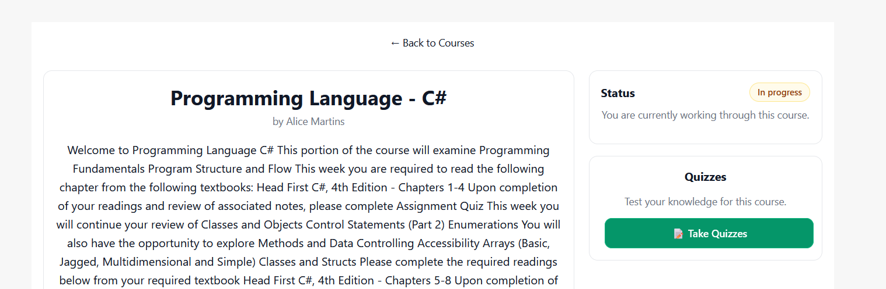
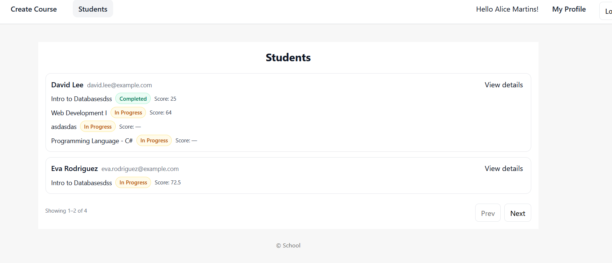
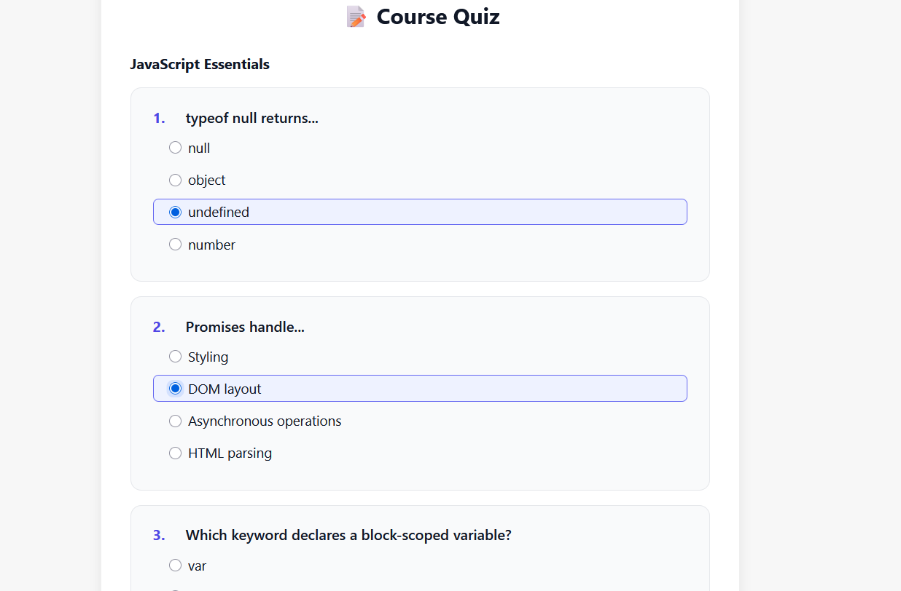
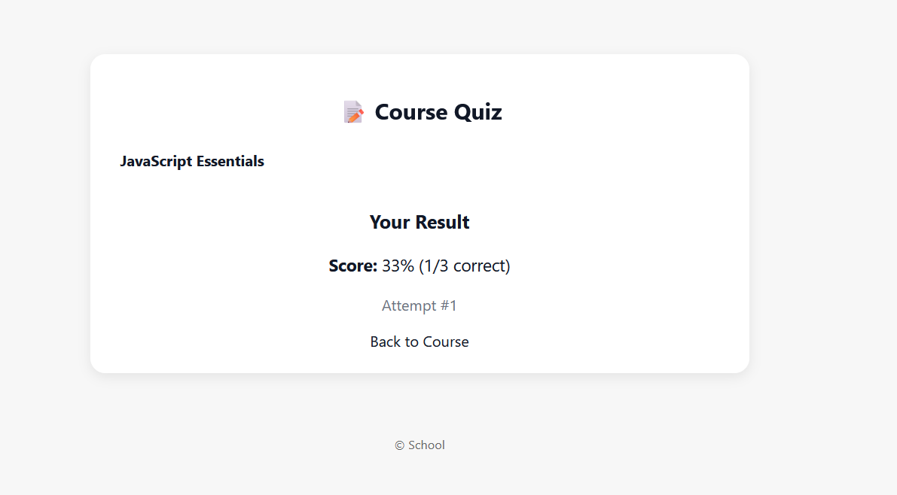
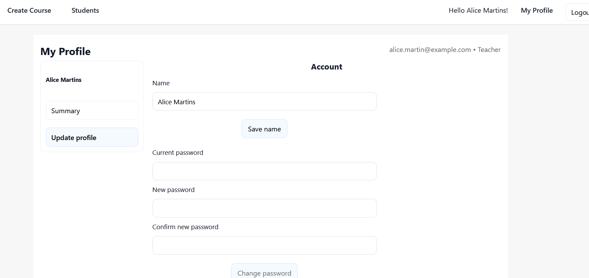

# 🏫 School Management Web App

**Full-Stack Internship Project – Technova IT (Sept–Oct 2025)**  
Developed by **Fy Andria**

---

## 📋 Overview

The **School Management Web App** is a full-stack educational platform designed to manage courses, teachers, students,
quizzes, and progress tracking.  
It provides separate dashboards for **Teachers** and **Students**, secure authentication, and a modular Node.js + React
architecture.  
This project was developed as part of Fy’s **Software Development Internship at Technova IT**, for **Herzing College
Toronto**.

---

## 🚀 Features

### 👩‍🏫 Teacher Area

- Create, edit, and delete courses
- Add and manage quizzes per course
- View students enrolled in each course
- Track student progress and quiz attempts
- Paginated course and student lists

### 🎓 Student Area

- View all available courses
- Enroll in or start courses
- Take quizzes and view results
- Track progress and performance
- Update personal profile information

### 🔐 Shared Features

- JWT authentication and role-based access
- RESTful Express API with modular structure
- SQLite database for easy development
- Responsive React frontend built with Vite

---

## 🧠 Architecture

```
intern-school/
├── client/   # React (Vite)
└── server/   # Express + SQLite
```

---

## ⚙️ Server (Backend)

### Folder Structure

```
server/
├── src/
│   ├── auth/
│   ├── courses/
│   ├── db/
│   ├── middleware/
│   ├── progress/
│   ├── quizzes/
│   ├── teacher/
│   └── users/
├── .env
├── app.js
├── index.js
├── package.json
└── package-lock.json
```

### Server Scripts

```json
{
  "scripts": {
    "dev": "nodemon index.js",
    "start": "node index.js",
    "db:init": "node src/db/init.mjs",
    "db:seed": "node src/db/seed.mjs",
    "db:reset": "rimraf ./src/db/school.db ./src/db/school.db-wal ./src/db/school.db-shm && npm run db:init && npm run db:seed",
    "lint": "eslint ."
  }
}
```

#### Script Descriptions

| Script             | Description                           |
|--------------------|---------------------------------------|
| `npm run dev`      | Run server with nodemon (auto-reload) |
| `npm start`        | Run server (production-style)         |
| `npm run db:init`  | Initialize database schema            |
| `npm run db:seed`  | Seed database with sample data        |
| `npm run db:reset` | Reset database completely             |
| `npm run lint`     | Run ESLint validation                 |

---

## 💻 Client (Frontend)

### Folder Structure (matches your repo)

```
client/
├── src/
│   ├── assets/
│   │   ├── react.svg
│   │   └── styles.css
│   ├── auth/
│   │   ├── Guard.jsx
│   │   ├── RequireStudent.jsx
│   │   └── RequireTeacher.jsx
│   ├── components/
│   │   ├── CourseForm.jsx
│   │   ├── DebugRoute.jsx
│   │   ├── LoginForm.jsx
│   │   ├── Navbar.jsx
│   │   ├── ProtectedRoute.jsx
│   │   ├── QuizForm.jsx
│   │   ├── QuizInline.jsx
│   │   ├── SignupForm.jsx
│   │   └── StartCourseButton.jsx
│   ├── context/
│   │   └── AuthContext.jsx
│   ├── lib/
│   │   └── api.js
│   ├── pages/                 # generic pages (not role-specific)
│   │   ├── HomePage.jsx
│   │   ├── LoginPage.jsx
│   │   ├── MyProfilePage.jsx
│   │   └── SignupPage.jsx
│   ├── student/               # role-specific screens (Student)
│   │   ├── CourseDetailPage.jsx
│   │   ├── MyCoursesPage.jsx
│   │   ├── QuizPage.jsx
│   │   ├── StudentCoursesPages.jsx
│   │   ├── StudentLayout.jsx
│   │   └── TakeQuizzesPage.jsx
│   ├── teacher/               # role-specific screens (Teacher)
│   │   ├── CourseDetail.jsx
│   │   ├── CourseEdit.jsx
│   │   ├── CourseNew.jsx
│   │   ├── QuizEdit.jsx
│   │   ├── QuizNew.jsx
│   │   ├── StudentDetailPage.jsx
│   │   ├── StudentProfilePage.jsx
│   │   ├── StudentsPage.jsx
│   │   ├── TeacherCoursesPage.jsx
│   │   └── TeacherLayout.jsx
│   ├── App.jsx
│   ├── App.css
│   ├── index.css
│   └── main.jsx
├── .env
├── package.json
└── vite.config.js
```

### Tech Stack

| Layer    | Technology                     |
|----------|--------------------------------|
| Frontend | React 18, React Router 6, Vite |
| Backend  | Node.js, Express.js            |
| Database | SQLite 3                       |
| Auth     | JSON Web Token (JWT)           |
| Tools    | ESLint, Prettier               |
| Styling  | CSS                            |

---

## ⚙️ Setup Instructions

### 1️⃣ Clone the Repository

```bash
git clone https://github.com/fyandriana/intern-school.git
cd intern-school
```

### 2️⃣ Install Dependencies

```bash
cd server && npm install
cd ../client && npm install
```

### 3️⃣ Database Setup

```bash
cd ../server
npm run db:reset
# or separately
npm run db:init
npm run db:seed
```

### 4️⃣ Environment Variables

**Server (`server/.env`):**

```
PORT=3001
JWT_SECRET=supersecretkey
DATABASE_URL=./src/db/school.db
```

**Client (`client/.env`):**

```
VITE_API_BASE=http://localhost:3001
```

### 5️⃣ Run the App

**Backend (API on http://localhost:3001):**

```bash
cd server
npm start
```

**Frontend (Vite on http://localhost:5173):**

```bash
cd ../client
npm run dev
```

---

## 🧾 API Highlights

| Method | Endpoint                         | Description                  |
|--------|----------------------------------|------------------------------|
| GET    | `/api/courses`                   | List all courses             |
| GET    | `/api/courses/:id`               | View course details          |
| POST   | `/api/courses`                   | Create course (Teacher only) |
| GET    | `/api/courses/:courseId/quizzes` | List quizzes for a course    |
| POST   | `/api/courses/:id/enroll`        | Enroll student               |
| GET    | `/api/progress/:studentId`       | View quiz attempts           |
| POST   | `/api/progress`                  | Submit quiz attempt          |

---

## 🧱 Design Principles

- Clear modular pattern: **DAO → Service → Controller → Route**
- Centralized error handling and validation middleware
- JWT authentication and role-based protection
- Clean UI with reusable React components
- Lightweight SQLite database for development

---

## 📅 Internship Timeline

| Week | Focus                | Deliverables              |
|------|----------------------|---------------------------|
| 1    | Database & Schema    | schema.sql, seed.sql      |
| 2    | Backend REST API     | Auth, Courses, Quizzes    |
| 3    | Frontend Integration | Auth, Course Pages        |
| 4    | Frontend Integration | Profiles(teacher/student) |
| 5    | Progress Tracking    | Attempts, README          |

---

## 🔑 Access Accounts

You can use the following demo accounts to log in and explore the app:

| Role | Email | Password |
|------|--------|-----------|
| 👩‍🏫 **Teacher** | alice.martin@example.com | alice.martin@example.com |
| 🎓 **Student** | david.lee@example.com | david.lee@example.com |


---

## 🖼️ Screenshots

> Located in `client/public/screens/`

### Login



### Teacher Dashboard



### Courses List (Teacher)



### Course Detail (Teacher)



### Students List (Teacher)



### Quiz (Student)



### Quiz Result (Student)



### My Profile



---

## 👩‍💻 Author

**Fy Andria**

---
